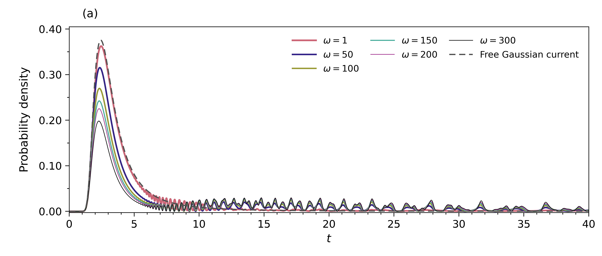
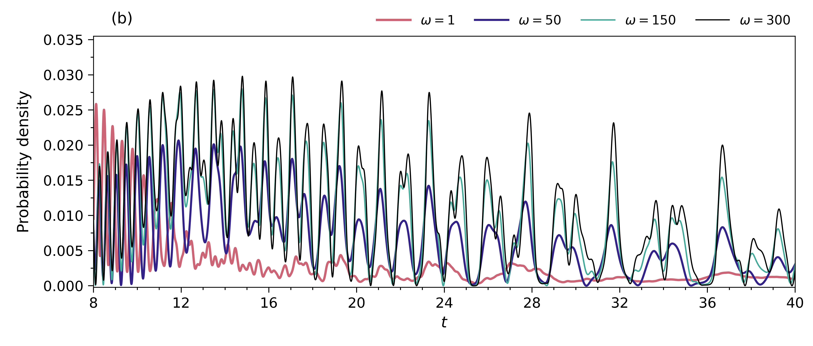
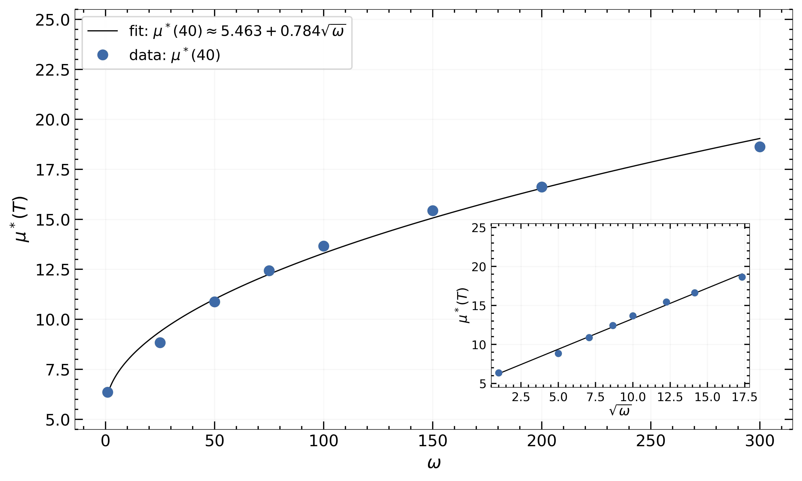
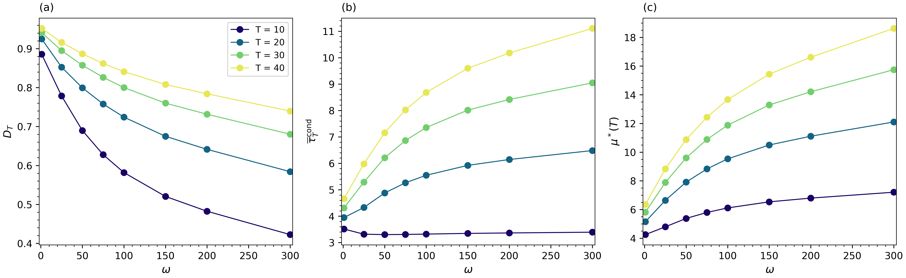
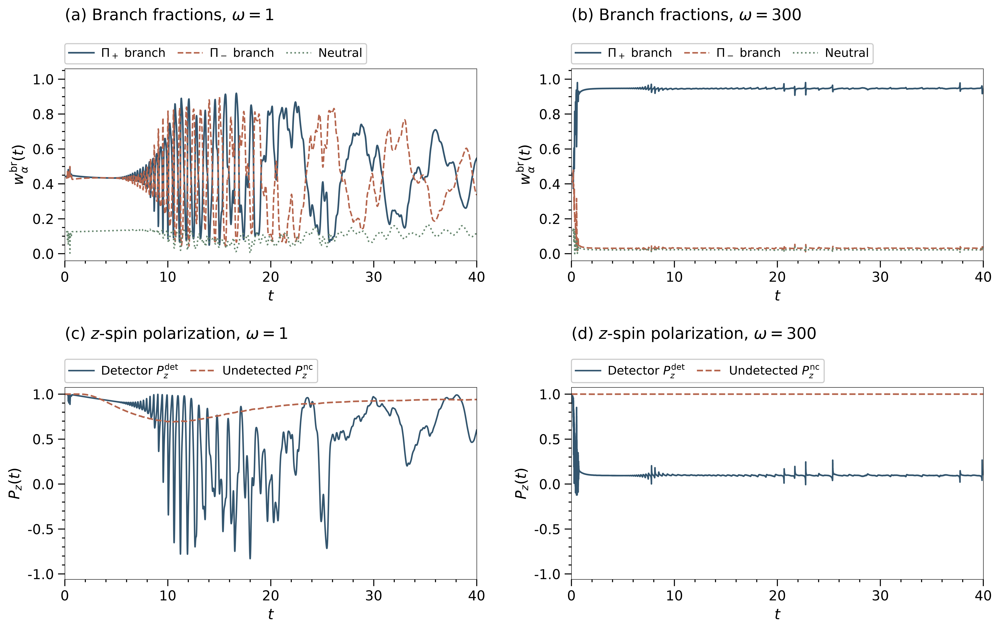

# Spin–Momentum Impedance and Filtering at a Spin-Coupled Absorbing Boundary

**Alireza Jozani — companion to the manuscript snapshot of 28 October 2026, including its Supplement.**

How can transverse confinement change the recorded click-time distribution when the longitudinal bulk Hamiltonian is unchanged? The spin-coupled detecting boundary reads transverse momentum and changes the surviving wave. Its response therefore depends on confinement, while the complete signal also depends on propagation, interference and the finite guide. This is the **detector-only Cartesian study, without an additional transverse environment**. The absorbing detector already makes the no-click evolution nonunitary.

[Reproduce the saved-data analyses](REPRODUCING.md) · [Supporting figures and tables](data/centered/README.md) · [Scope and source discrepancies](PROJECT_SCOPE.md) · [Existing simulation animations](data/3DGifs_Simulations/)

## What the boundary reads

For tangential wave vector $\xi$, the boundary symbol and its eigenvalues are

```math
C(\xi)=i\kappa I+(\hat z\times\xi)\cdot\boldsymbol\sigma,
\qquad R=|\xi|,\qquad \lambda_\pm=i\kappa\pm R.
```

At fixed incident normal wave number $k>0$ and detector parameter $\kappa>0$, both local branches have the same one-encounter absorption probability:

```math
A_+(k,R)=A_-(k,R)=\frac{4k\kappa}{(k+\kappa)^2+R^2}.
```

Increasing tangential momentum suppresses this local absorption. The reflected phases generally differ between branches, so spin–momentum filtering is not unequal local absorption of two fixed laboratory-spin orientations. For the incident transverse oscillator ground state the characteristic tangential momentum grows as $\sqrt\omega$. That local scale does not determine the whole time distribution or prove a universal square-root law.

## Detection is reshaped, not uniformly delayed

The reference preparation has $L=20$, source center $z_c=10$, $k_z=\kappa=\pi$, Gaussian **amplitude** width $\sigma_\parallel=0.5$, and initial spinor $(1,0)^T$. The numerical roof is at the recorded endpoint-excluded coordinate, approximately $19.986666$, rather than exactly $20$.



*Fig. 1a candidate: launch-normalized detector-event density through T=40. The dashed detector-free Gaussian current is a separate comparison, not a click record. This identified archived export uses the half-step case 7706 at ω=300; [inputs](data/centered/native/figures_main/) and [per-item provenance](data/centered/provenance/manifest.json). Exact embedded-manuscript image identity is not asserted.*



*Fig. 1b candidate: late-time detail for ω=1,50,150,300, from the separately identified export with the matching confinement subset. It also uses 7706 at ω=300. Late-profile structure remains resolution-sensitive; [native records](data/centered/native/7706/).*

Stronger confinement suppresses prompt detection and changes the relative weight and structure of the tail. The early conditional click time changes only weakly. Over the sampled confinements, the conditional mean increases at T=20,30,40; its T=10 behavior is weak and nonmonotonic. An early/late split is a statistical decomposition, not an identification of each peak with a unique trajectory or round trip.

For density $g(t)$ and survival $S(t)$, three finite-window observables must be distinguished:

```math
D_T=\int_0^T g(t)\,dt,\qquad
\overline\tau_{\rm cond}(T)=\frac{\int_0^T t g(t)\,dt}{D_T},
```

```math
\mu^*(T)=\int_0^T S(t)\,dt
=D_T\overline\tau_{\rm cond}(T)+T(1-D_T).
```

The identity describes the ideal detector law. Distributed numerical reductions retain event-derived $D_T$, stored survival and their small accounting discrepancy separately; casting and boundary-clamp losses are not clicks.

| ω | D₄₀ | Conditional mean | Restricted mean μ*(40) |
|---:|---:|---:|---:|
| 1 | 0.952 | 4.663 | 6.358 |
| 100 | 0.841 | 8.683 | 13.666 |
| 300 | 0.740 | 11.113 | 18.631 |

These rounded values belong to the **baseline** family, including case 7100 at ω=300. They are recomputed from compact native records and compared with the archived Tables S2–S4. Approximately 26% remains undetected at T=40 for ω=300, contributing substantially to the restricted mean. This is not evidence of permanent non-detection.



*Fig. 2 identified archived export: the baseline eight-point T=40 fit, including 7100. The main reduction separately retains the archived Simpson recipe and the Supplement's piecewise-linear survival check; [inputs and source selection](data/centered/native/figures_main/).*

The reference empirical fit over $\omega\in\{1,25,50,75,100,150,200,300\}$ is

```math
\mu^*(40;\omega)\simeq 5.463+0.784\sqrt\omega.
```

Its coefficients summarize this preparation, geometry, detector and finite window. Fit residuals are not numerical-convergence errors, and the old repository's T=20 fit is a separate historical product.



*Fig. 3 candidate: detected fraction, conditional mean and restricted mean at T=10,20,30,40 from common histories. This later export uses 7706 at ω=300, unlike Fig. 2. Open the image for full-resolution panel labels; [inputs](data/centered/native/figures_main/) and [version distinctions](PROJECT_SCOPE.md#source-version-differences).*

## Branch weights and spin describe different ensembles

[](data/centered/figures/FigS1.png)

*Fig. S1 archived candidate: ω=1,300 branch fractions and laboratory-z polarization through T=40, with baseline 7100. [Native diagnostics](data/centered/native/7100/) and [reproduction levels](REPRODUCING.md) distinguish instantaneous traces from ratios of integrated quantities.*

At ω=300 the integrated plus-branch fraction is approximately 0.946, detector-associated z-polarization approximately 0.097, and final whole-survivor z-polarization nearly 1. Momentum-dependent tangential branches are not fixed laboratory-z spin states. These results concern different weightings and ensembles: they are neither “95% spin-up absorption,” apparatus-spin measurements, nor the polarization of an isolated reflected packet. The neutral branch sector is retained.

## Geometry, escape and the long tail

The [lower-wall and long-time gallery](data/centered/README.md#geometry-and-the-long-tail) links **Figs. S11–S13 and Tables S11–S12**. Moving the lower wall with source and detector fixed changes late detection while preserving the reported early statistics. At ω=200, adding a partially absorbing lower boundary reduces reported late upper detection from about 0.438 to 0.130. Lower escape is a separate outcome: surviving mass plus upper detection plus lower escape approximately closes the budget. The probability of no upper click includes escaped particles.

The long-time calculation records substantial detection beyond T=40. The manuscript's logged-survival estimate ends at **189.95**, whereas the available native norm support now reaches **200**. Neither determines the unrestricted mean. Finite-guide memory is not identified here with bath non-Markovianity.

## Supplementary results and controls

The [table catalog](data/centered/tables/README.md) presents **Tables S1–S12** with readable panels, definitions and canonical CSV links. The [supporting gallery](data/centered/README.md) indexes **Figs. S1–S13** and distinguishes archived exports from manuscript extracts. Each result states its numerical family and available reproduction level.

| Scientific group | Tables and figures |
|---|---|
| Finite-window statistics and scalar controls | [Table S1 settings](data/centered/tables/README.md#table-s1), [Table S2 early/late statistics](data/centered/tables/README.md#table-s2) |
| Boundary/spin diagnostics and refinement | [Tables S3–S5](data/centered/tables/README.md#table-s3), [Fig. S1](data/centered/README.md#fig-s1) |
| Bulk/preparation and absorbing-layer controls | [Tables S6–S8](data/centered/tables/README.md#table-s6), [Fig. S2](data/centered/README.md#fig-s2) |
| Source/detector/geometry parameter studies | [Tables S9–S10](data/centered/tables/README.md#table-s9), [parameter figures](data/centered/README.md#parameter-and-guide-length-controls) |
| Lower-boundary controls and long-time detection | [Tables S11–S12](data/centered/tables/README.md#table-s11), [Figs. S11–S13](data/centered/README.md#geometry-and-the-long-tail), [long-time summary](data/centered/tables/README.md#long-time-summary) |

## Controls, numerical scope and reuse

Scalar, bulk-spin, chiral-preparation, source/detector-parameter and geometry controls test specific alternatives, not arbitrary preparations. The [scope document](PROJECT_SCOPE.md) records legacy preparation differences and missing layer/width inputs. The auxiliary inward continuation is not a physical absorber, and its covariance does not determine the empirical fit. The reduced return-kernel closure is an assumed interpretation, not the simulator generating these curves. Layer calibration is a separate manuscript-reported study: better entrance matching need not reproduce an entire click-time law.

The centered family uses the ghost-point roof closure and compatible half-weight terminal norm. Integrated branch/spin contrasts survive the tested refinements, while detailed profiles and auxiliary quantities remain sensitive. Actual timesteps disagree with manuscript Table S1; the discrepancy is retained beside the [per-run settings](PROJECT_SCOPE.md#source-version-differences).

The [unchanged legacy movies](data/3DGifs_Simulations/) have their own configurations and do not reproduce the revised θ=0 family. Autoscaled brightness cannot establish absorption probabilities. No new animation or production simulation is required for this update.

The saved-data workflow is CPU-only and offline after installation. Start with [REPRODUCING.md](REPRODUCING.md); use [CITATION.cff](CITATION.cff) and the [paper context](paper/README.md) for attribution. Original heavy states, private inventory reports and the supplied manuscript PDF are not distributed here.
