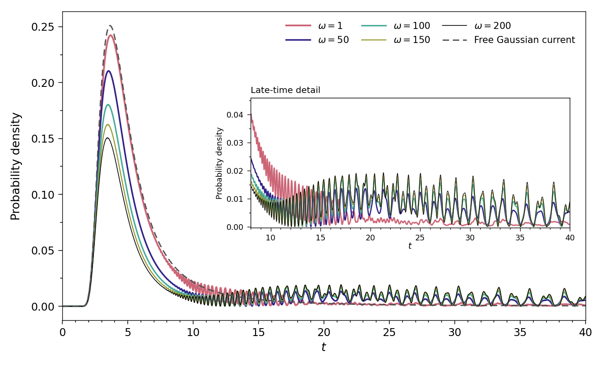
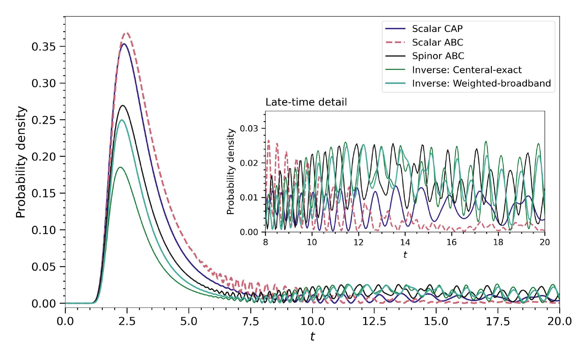
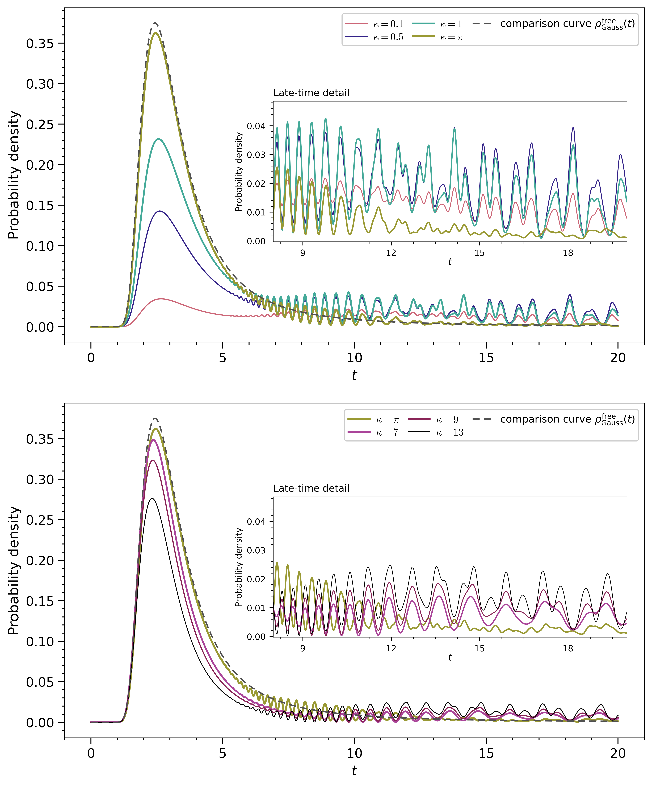
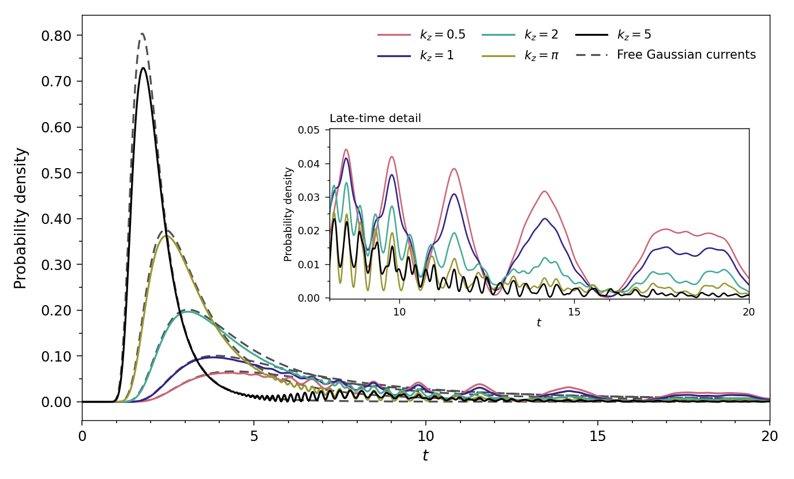
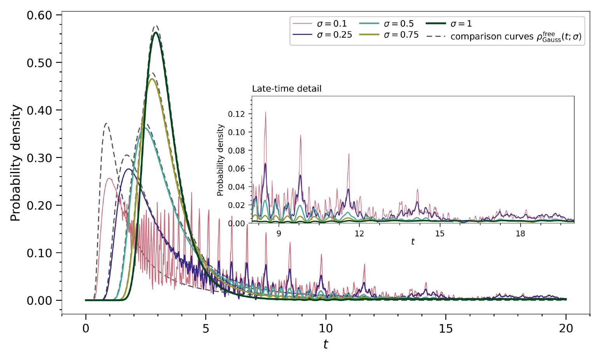

# Centered results and supporting gallery

This gallery accompanies the **28 October 2026** manuscript snapshot, *Spin–Momentum Impedance and Filtering at a Spin-Coupled Absorbing Boundary*. It presents the Cartesian detector-only study; the absorbing detector makes the no-click evolution nonunitary. Times, coordinates and parameters use the manuscript's dimensionless units. A plotted Cartesian coordinate is not an oscillator-scaled coordinate.

Start with the [main results](../../README.md), [Tables S1–S12](tables/README.md), [CPU reproduction instructions](../../REPRODUCING.md), [scope and version differences](../../PROJECT_SCOPE.md), and [single provenance manifest](provenance/manifest.json). Click any preview for its full distributed resolution. Figure display, replotting from derived data, native-data reduction and a fresh simulation are different capabilities; the status below states which is available.

| Scientific group | Figures | Numerical tables and status |
| --- | --- | --- |
| Boundary branches, spin and refinement | [Fig. S1](#fig-s1) | [Tables S3–S5](tables/README.md#table-s3); native aggregate diagnostics and refinement reductions |
| Bulk/preparation and absorbing layers | [Fig. S2](#fig-s2) | [Tables S6–S8](tables/README.md#table-s6); archived control results and clearly marked manuscript values |
| Centered parameter and guide studies | [Fig. S4](#fig-s4), [Fig. S6](#fig-s6), [Fig. S8](#fig-s8), [Fig. S9](#fig-s9), [Fig. S10](#fig-s10) | [Table S10](tables/README.md#table-s10), linked derived tables; Fig. S9 has an unresolved method discrepancy |
| Legacy fixed-confinement profiles | [Fig. S3](#fig-s3), [Fig. S5](#fig-s5), [Fig. S7](#fig-s7) | [Table S9](tables/README.md#table-s9); one-sided closure and source qualifications retained |
| Lower wall, escape and long time | [Fig. S11](#fig-s11), [Fig. S12](#fig-s12), [Fig. S13](#fig-s13) | [Tables S11–S12](tables/README.md#table-s11) and [long-time summary](tables/README.md#long-time-summary) |

The [existing simulation media](../3DGifs_Simulations/) are unchanged legacy visualizations with their own preparations. No revised centered-family movie is added. Autoscaled brightness does not measure probability conservation or detection efficiency.

<a id="fig-s1"></a>

## Branches and spin: Fig. S1

[](figures/FigS1.png)

**What is shown.** Time-dependent boundary fractions in the plus, minus and neutral sectors (top), and detector-associated and whole-survivor laboratory-z spin polarizations (bottom). Left/right use ω=1/300, T=40, L=20, source center 10, kz=κ=π, Gaussian amplitude width 0.5 and initial spinor (1,0). The horizontal axis is time; the vertical axes are dimensionless fractions or polarizations. Curves connect defined recorded ratios without smoothing.

The integrated plus-branch weight at ω=300 is large even though detector-associated z-polarization is small, while the final whole-survivor z-polarization is nearly one. Momentum-dependent branch labels are not fixed laboratory-z spin labels, and unequal evolved branch weights do not imply unequal local absorption coefficients. The whole survivor is not an isolated reflected packet.

**Data and status.** [Table S4](tables/README.md#table-s4) gives all eight integrated rows and the neutral sector; [Table S5](tables/README.md#table-s5) records resolution sensitivity. [Derived plotting arrays](native/figures_diagnostics/FigS1_plot_data.npz), [native ω=1](native/5540/) and [native ω=300](native/7100/) support the [diagnostics adapter](../../Loaders/centered/diagnostics.py) and [rendering recipe](../../Loaders/centered/s1_render.py). This archived export uses baseline 7100, whereas the displayed main Fig. 1/3 candidates use 7706. Aggregate native reduction and derived replot are supported; no new spectral-field reconstruction is claimed.

<a id="geometry-and-the-long-tail"></a>
<a id="fig-s11"></a>

## Fixed-source lower-wall displacement: Fig. S11 and Table S11

[](figures/FigS11.png)

**What is shown.** Signed longitudinal finite-difference link current, summed over transverse grid and spin and normalized by launch norm, at ω=200 over 0≤t≤40. Panels (a)–(d) use lower-wall positions zB=0,−5,−10,−15 with source zc=10 and detector zD≈19.9867 fixed. Horizontal time and vertical Cartesian z are physical coordinates within the dimensionless model, not oscillator-scaled coordinates. Red/blue mean current toward/away from the detector; gray is outside the guide. Dashed/dotted monitors remain at z≈16.007,18.007.

All four panels retain the same signed color scale and original saturation limits. The maps show net transport of undetected probability and how its later evolution changes with wall position; they are neither density maps nor individual particle trajectories. They do not identify a unique round trip for each oscillation.

**Data and status.** [Table S11](tables/README.md#table-s11), its [full-precision CSV](tables/controls/S11/table_S11_fixed_source_T40.csv), [plot metadata](tables/controls/S11/plot_metadata.json) and [historical plotting recipe](../../Solvers/centered/controls/analysis/S11/plot_currents.py) identify cases 7750–7753. The complete archived export was resized in the first repository pass; its numerical spatial histories are not bundled, so the [controls adapter](../../Loaders/centered/controls.py) displays the map and table. These runs use dt=0.0003, distinct from main case 5045's dt=0.00025. Early probability is approximately unchanged at the reported precision; the overall detected conditional mean is nonmonotonic.

<a id="fig-s12"></a>

## Lower escape versus upper detection: Fig. S12 and Table S12

[](figures/FigS12.png)

**What is shown.** Unconditional upper-detector click density versus time at ω=200, L=20, kz=κ=π, amplitude width 0.5 and initial spinor (1,0), through T=40. Green is case 5045 with a Dirichlet lower wall; purple is case 7800 with a separate scalar lower boundary of κlower=π. The inset resolves 5≤t≤35. Neither curve is conditioned on eventual upper detection; each area is its upper-click probability.

The lower absorber reduces late upper detection by letting probability escape below, while retaining partial reflection. Lower escape is a separate outcome, so total norm loss is not the upper-detection probability:

```math
S_{\mathrm{in}}+D_{\mathrm{top}}+E_{\mathrm{lower}}\simeq1,\qquad
P(\text{no upper click by }t)=S_{\mathrm{in}}+E_{\mathrm{lower}}.
```

The approximation retains the measured numerical accounting defect. The capped upper-click mean integrates 1−Dtop and differs from the integral of surviving mass.

**Data and status.** [Table S12](tables/README.md#table-s12) contains all four ω=1,200 comparisons and preserves the rounded Dirichlet-row convention. [Native 7800](native/controls/7800/), [native 7801](native/controls/7801/) and [5045](native/5045/) retain the relevant records. The [controls adapter](../../Loaders/centered/controls.py) recomputes two-channel quantities and replots the upper-click comparison; [historical plotting source](../../Solvers/centered/controls/analysis/S12/plot_arrival_time.py) is also included. [Archived comparison CSV](tables/controls/T12/four_way_statistics.csv) and [horizon records](tables/controls/T12/horizons_comparison.csv) retain their separate definitions.

<a id="fig-s13"></a>

## Long-time tail: Fig. S13

[](figures/FigS13.png)

**What is shown.** Detector-event density versus time for case 7810, ω=200, centered roof and reflecting lower wall, L=20, zc=10, kz=κ=π, amplitude width 0.5 and initial spinor (1,0). The plot spans 0–200 with nested insets 8–200 and 80–200; no detector-free comparison is drawn. The existing PNG is a complete 150 dpi raster of the identified archived black-curve PDF.

Substantial detection occurs after T=40, so finite-window survival is not permanent non-detection. The manuscript's logged-survival estimates end at **189.95**, while the available plotted and sampled-norm support now reaches **200**; these are reported separately. A single-confinement time extension determines neither the unrestricted mean nor a long-horizon confinement law, and does not resolve individual encounters.

**Data and status.** The [long-time summary](tables/README.md#long-time-summary) is a repository summary, not a nonexistent Table S13. [20,000-bin plotted data](native/controls/7810/plot_data.csv), [metadata](native/controls/7810/plot_metadata.json), [actual norm times](native/controls/7810/prob_times.npy) and [sampled norms](native/controls/7810/total_probs.npy) support the [controls adapter's](../../Loaders/centered/controls.py) derived-bin replot and support checks. The [historical recipe](../../Solvers/centered/controls/analysis/S13/plot_arrival_time.py) used native accepted-step events; its complete 800,000-step record is not bundled. Derived D200≈0.943070 is not substituted for the manuscript's D189.95≈0.941.

## Parameter and guide-length controls

The following centered confinement sweeps retain complete archived exports and derived numerical tables. The [controls command](../../Loaders/centered/controls.py) displays these records; it does not independently reconstruct every parameter run or regenerate the curves. Fit residuals measure empirical fit agreement, not discretization accuracy.

<a id="fig-s4"></a>

### Fig. S4 — Detector-parameter confinement sweeps

[](figures/FigS4.png)

Restricted mean μ*(20) is plotted against ω for κ=2,π,7, with kz=π, amplitude width 0.5 and L=20. All three use ω={1,25,50,100,150,200}; markers are calculated values and lines are empirical fits. Restricted means rise across this sample, but the ordering of detector settings changes with confinement. These T=20 coefficients do not replace the main T=40 fit or establish a universal law.

**Data and status.** [Full-precision values](tables/controls/S4/fig_S4_centered_T20.csv), [fit summary](tables/controls/S4/fig_S4_centered_fit_summary.csv), [historical reduction recipe](../../Solvers/centered/controls/analysis/S4/recalculate_fig_S4.py). Centered implementation; archived derived results and figure display, without bundled histories for all parameter runs.

<a id="fig-s6"></a>

### Fig. S6 — Longitudinal-momentum confinement sweeps

[](figures/FigS6.png)

Restricted mean μ*(20) versus ω compares kz=2,π,5 at κ=π, amplitude width 0.5 and L=20, using the same six confinements as Fig. S4. Markers and fitted lines show the preparation-dependent confinement contrast. The fitted coefficients describe this finite sample and horizon; the different longitudinal speeds also change the prompt flight time.

**Data and status.** [Table S10](tables/README.md#table-s10) presents all three fits and residuals. [Fit inputs](tables/controls/S6/fig_S6_centered_T20.csv), [fit summary](tables/controls/S6/fig_S6_centered_fit_summary.csv), [historical recipe](../../Solvers/centered/controls/analysis/S6/reproduce_fig_S6.py). Centered implementation; archived numerical results and export. The original Table S10 reducer's provenance helper is missing, so its file is not presented as an executable complete native reconstruction.

<a id="fig-s8"></a>

### Fig. S8 — Packet-width confinement sweeps

[](figures/FigS8.png)

Restricted mean μ*(20) versus ω compares Gaussian amplitude widths 0.25,0.5,0.75 at kz=κ=π and L=20. All three use ω={1,25,50,100,150,200}; the restricted mean rises across each sampled family with width-dependent fit coefficients. Width changes both spatial localization and longitudinal momentum spread. This centered sweep does not replace the legacy fixed-confinement profiles in Fig. S7, nor incomplete centered width runs ending near 17.7–17.8.

**Data and status.** [Full-precision data and completion flags](tables/controls/S8/results_full_precision.csv), [fit coefficients](tables/controls/S8/fit_coefficients.csv), [residuals](tables/controls/S8/fit_residuals.csv), [historical recipe](../../Solvers/centered/controls/analysis/S8/reproduce_fig_s8.py). Archived derived table and figure display; native reconstruction inputs for the full campaign are not bundled.

<a id="fig-s10"></a>

### Fig. S10 — Midpoint-source guide-length comparison

[](figures/FigS10.png)

Restricted mean μ*(40) versus ω compares nominal L=20 and 30 at ω={1,25,50,75,100,150,200}, with kz=κ=π and amplitude width 0.5. Both use source zc=L/2, so source-detector distance changes with guide length. The larger guide gives a larger restricted mean in the sampled family. This comparison is distinct from Fig. S11's displacement of the lower wall at fixed source and detector.

**Data and status.** [Statistics and validation](tables/controls/S10/S10_statistics_and_validation.csv), [fit coefficients](tables/controls/S10/S10_fit_coefficients.csv), [historical recipe](../../Solvers/centered/controls/analysis/S10/reproduce_s10.py). Centered implementation; archived numerical results and display. Fitted lines are finite-window summaries, not a propagation-independent boundary law.

<a id="fig-s9"></a>

### Fig. S9 — Longer-guide profiles: reconstruction method unresolved

[](figures/FigS9.png)

The located export plots unconditioned detector-event density against time through T=40 for ω=1,50,100,150,200 in nominal L=30, zc=15, kz=κ=π and amplitude width 0.5. Its actual detector coordinate is approximately 29.9850; the gray dashed curve is the separate detector-free Gaussian comparison, and the inset resolves late structure. Confinement changes prompt and late response in this longer guide; the comparison does not isolate a universal timing shift.

**Source discrepancy and status.** The manuscript caption says numerical differentiation of raw saved squared norms. The identified export's provenance and script instead use accepted-step upper-event probability divided by launch norm and step duration, with no differentiation or curve renormalization. This is an **archived event-derived candidate**, not a verified survival-derivative reconstruction of the caption. [Manifest source records](provenance/manifest.json) identify cases 7700,7702–7705, original tables and plotting recipe; those curve-level tables are not bundled. The adjacent [Fig. S10 statistics](tables/controls/S10/S10_statistics_and_validation.csv) provide a different, archived integrated comparison and cannot regenerate these curves. The supplied caption also says red dashed, while the supplied image and identified export use gray dashed.

<a id="fig-s2"></a>

## Absorbing layers and bulk/preparation controls: Fig. S2

[](figures/FigS2.png)

**What is shown.** Detection-time density versus time at ω=100 over 0≤t≤20 for spinor ABC, scalar CAP, scalar ABC, central-exact inverse layer and weighted-broadband inverse layer with wc=2. Common bins have width 0.04; the inset resolves 8≤t≤20. All curves retain their absolute normalization, without time shift, amplitude rescaling or conditioning on detection.

Broadband calibration improves the reported integrated comparison relative to central-exact calibration, yet the complete profiles still differ. Matching an auxiliary stationary entrance impedance does not establish equality of propagated click-time laws; probability stored inside a layer also separates entrance current from layer detection rate. An auxiliary inward continuation is not itself a physical absorbing layer.

**Data and status.** This is the **manuscript figure; curve-level numerical inputs are not bundled**. It is a faithful figure-region raster from PDF page 44 (printed Supplement page 31), preserving every curve, legend and inset. [Tables S7–S8](tables/README.md#table-s7) provide explicitly labeled manuscript-reported rounded numerical comparisons; [Table S6](tables/README.md#table-s6) separately presents all bulk-spin and chiral-preparation controls. [Extraction recipe](../../Loaders/centered/extract_manuscript_figures.py) and [manifest](provenance/manifest.json) record the manuscript hash, page and crop. The image is presentation evidence, not a numerical reconstruction.

## Legacy one-sided fixed-confinement profiles

These fixed-ω=1 profiles retain the earlier one-sided normal-boundary closure described in the Supplement. They are separate from the centered sweeps above. Their dashed Gaussian currents are detector-free comparisons, not detector-present click records. No curves were regenerated, smoothed, recolored or digitized during this update.

<a id="fig-s3"></a>

### Fig. S3 — Legacy detector-parameter profiles

[](figures/FigS3.png)

Time profiles of detector density are shown for ω=1, kz=π, amplitude width 0.5 and T=20: top is manuscript panel (a), κ=0.1,0.5,1,π; bottom is panel (b), κ=π,7,9,13. Both complete original panels are stacked for readability without resizing their pixels. Insets magnify late time, and the dashed gray Gaussian comparison is unchanged.

Changing κ reshapes prompt and late detection; the κ setting with the smallest restricted mean at ω=1 need not retain that ordering in the centered confinement sweep. [Table S9](tables/README.md#table-s9) retains all nine manuscript-reported κ values, including values not plotted here, and exposes source disagreements rather than silently combining families.

**Source qualifications and status.** This is an identified archived export, not fresh native reconstruction. Its recipe differentiates saved norms with `-np.gradient(P,t)`, default `edge_order=1`. Source κ=1 has θ=π/3 and dt=0.0008, whereas the other shown cases have θ=0 and dt=0.001; the κ=π recorded detector is 19.9867 versus nominal 20 for the others. Numerical histories are outside the bundled scope. [Manifest](provenance/manifest.json) records source exports/provenance and omitted recipe inputs; the [preview utility](../../Loaders/centered/extract_manuscript_figures.py) only assembles existing pixels. The manuscript caption calls the comparison red dashed, but its image and these original exports show gray dashed.

<a id="fig-s5"></a>

### Fig. S5 — Legacy longitudinal-momentum profiles

[](figures/FigS5.png)

Detector density versus time through T=20 compares kz=0.5,1,2,π,5 at ω=1, κ=π and Gaussian amplitude width 0.5. Separate gray dashed free-Gaussian currents accompany the corresponding longitudinal preparations; the inset shows late-time structure. Changing kz changes both the prompt flight time and the subsequent detector response, so these profiles do not imply a preparation-independent delay.

**Source qualifications and status.** This complete original preview is copied byte-for-byte. The archived one-sided recipe uses a derivative of saved norms. The kz=0.5,1 sources have θ=π/6 and complex128 states, whereas kz=2,π,5 have θ=0 and complex64; recorded detector positions also differ slightly around 20. These qualifications limit a strict one-parameter interpretation. [Source/recipe records](provenance/manifest.json) and [scope](../../PROJECT_SCOPE.md) retain the distinctions; native histories and their generating solver are not bundled. The caption says red dashed but the manuscript image and export show gray dashed. [Fig. S6 and Table S10](#fig-s6) describe the separate centered confinement sweep.

<a id="fig-s7"></a>

### Fig. S7 — Legacy packet-width profiles

[](figures/FigS7.png)

Detector density versus time through T=20 compares Gaussian **amplitude** widths 0.1,0.25,0.5,0.75,1 at ω=1 and kz=κ=π. The inset retains the late oscillatory structure, and dashed Gaussian comparison currents use the corresponding preparations. Narrower packets display more pronounced structure while changing both localization and momentum spread; that observation does not establish numerical convergence of each narrow feature.

**Data and status.** This is the **manuscript figure; original one-sided numerical inputs and plotting recipe were not located**. A faithful figure-region raster from PDF page 48 (printed Supplement page 35) preserves axes, legends and inset. [Extraction method](../../Loaders/centered/extract_manuscript_figures.py) and [manifest](provenance/manifest.json) record the PDF hash and crop. The independently located centered width results belong to [Fig. S8](#fig-s8), not this figure. The manuscript caption says red dashed, although its embedded comparison curves are gray dashed.

## Other controls and incomplete coverage

The [table catalog](tables/README.md) presents Tables S1–S12 with implementation and reproduction status separately identified. [Finite-window and scalar statistics](tables/README.md#table-s2) retain the diagnostic tcut=3.6 split and the scalar control's one-sided/full-weight survival convention. [Boundary diagnostics](tables/README.md#table-s3) retain the distinction between plane flux, branch-time integrals and accepted-step events. [Refinement](tables/README.md#table-s5) retains all four manuscript runs, including Nz=2999 rather than the later Nz=4000 case.

Historical `s4_*` and `s7_*` files in [the earlier diagnostic collection](../processed-summary-diagnostics-tables/) keep their public paths. Their names refer to an older organization and are not evidence that they are revised Supplement items. Use the numbered table catalog, this gallery and the [manifest](provenance/manifest.json) for the revised counterparts.

Presentation now covers all thirteen supplementary figures, but reproduction coverage remains narrower. Archived images or manuscript transcriptions are not counted as independent native reconstructions. No production solver runs during the [saved-data workflow](../../REPRODUCING.md); historical scripts under [the controls source area](../../Solvers/centered/controls/) may require omitted inputs.
