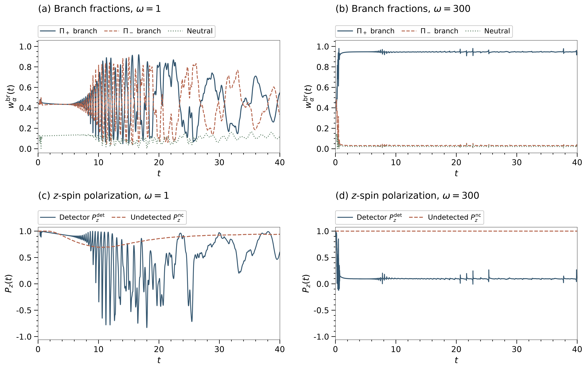
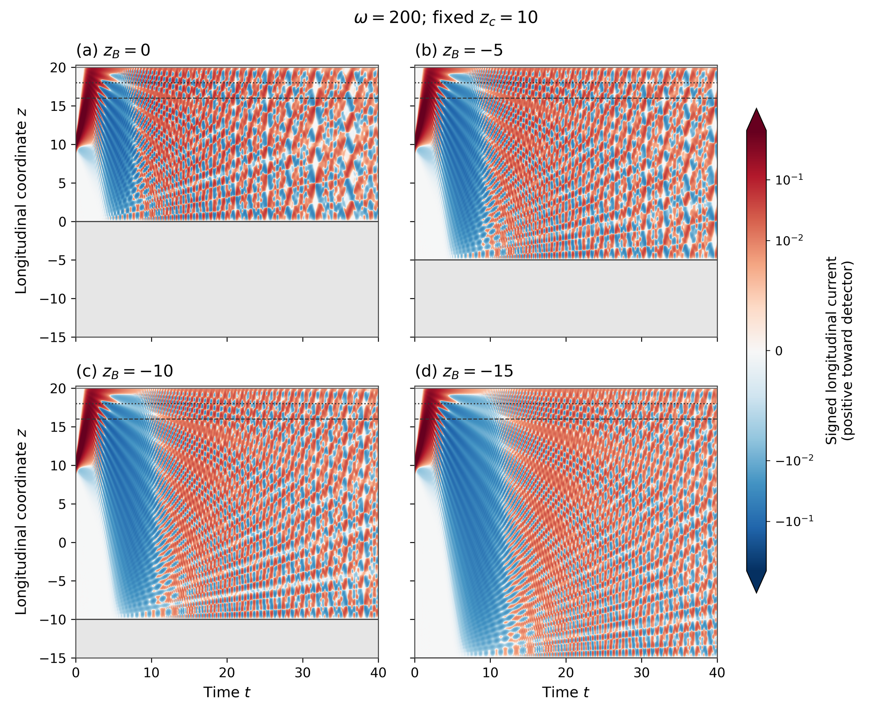
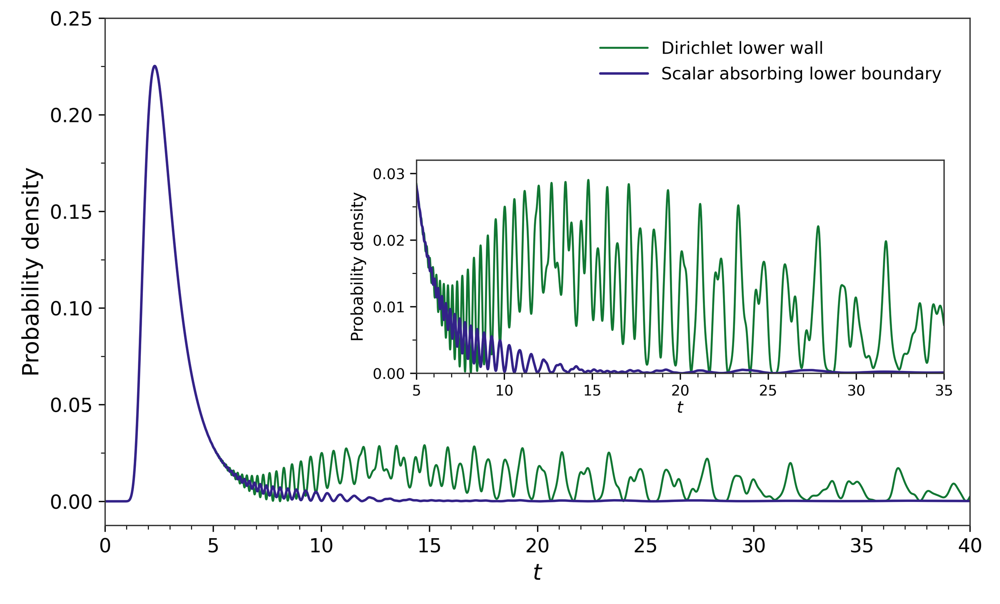
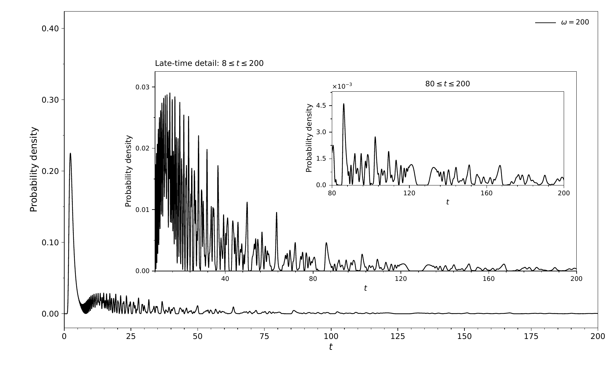
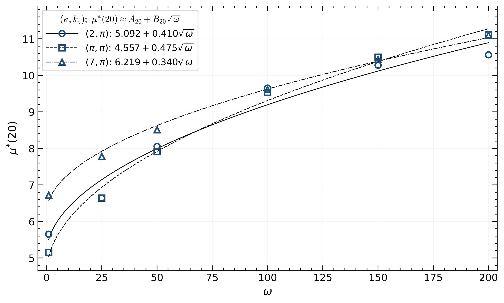
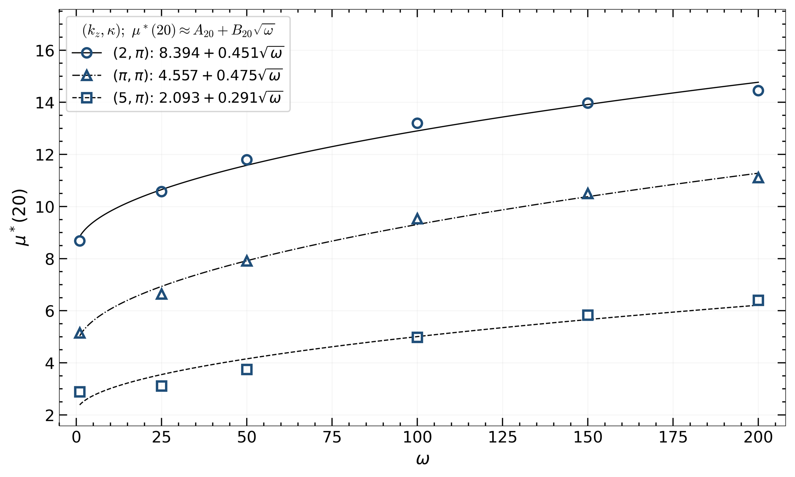
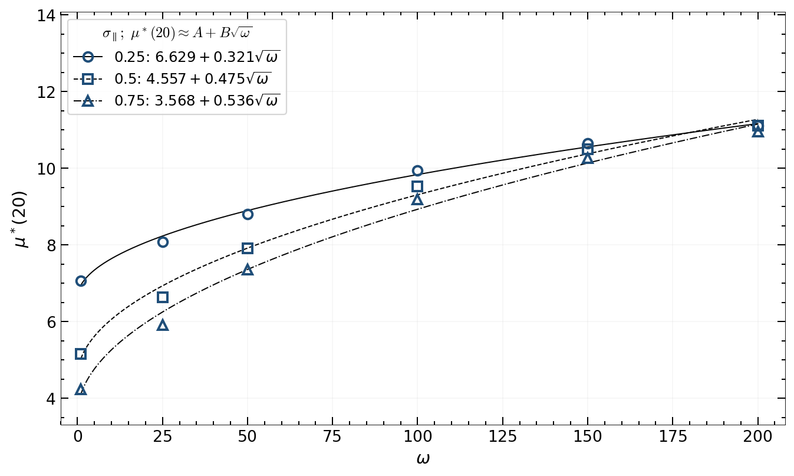
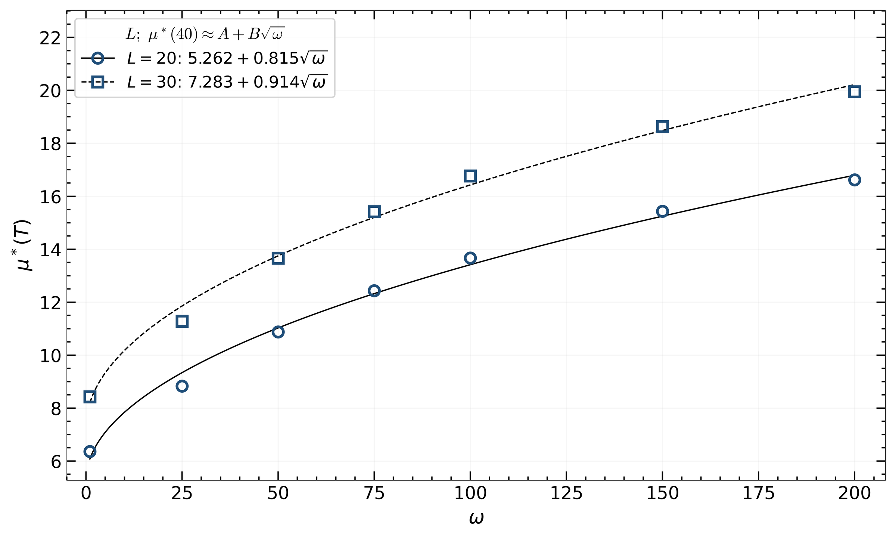

# Centered results and supporting gallery

This area accompanies the **28 October 2026** snapshot of *Spin–Momentum Impedance and Filtering at a Spin-Coupled Absorbing Boundary*. It is the Cartesian detector-only study: no additional transverse environment is present. The detector makes the no-click evolution nonunitary.

Start with the [main figures](../../README.md), [CPU reproduction instructions](../../REPRODUCING.md), [scope and version differences](../../PROJECT_SCOPE.md), and the [single run/asset manifest](provenance/manifest.json). The manifest records original-source and distributed hashes, transformations, source selections and reproduction levels. An identified archived export is not claimed to be the exact image embedded in the manuscript.

The [existing simulation media](../3DGifs_Simulations/) remain unchanged. They are legacy qualitative visualizations with their own preparations; no revised centered-family movie is included. Autoscaled brightness does not measure probability conservation or detection efficiency.

## Branches and spin: Fig. S1

**Observable and source.** Tangential branch fractions and laboratory-z spin for the reference ω=1 and 300 runs through T=40. The detector-associated ensemble and the whole surviving ensemble use different weights. The plus-branch fraction is not a laboratory-spin-up absorption fraction. See the [diagnostics workflow](../../Loaders/centered/diagnostics.py) and [manifest](provenance/manifest.json); this export uses baseline case 7100 at ω=300, whereas the displayed main Fig. 1/3 candidates use 7706.

## Fixed-source lower-wall displacement: Fig. S11 and Table S11

**Observable and source.** Signed longitudinal bond current, positive toward the detector, at ω=200 over 0≤t≤40. Four lower-wall positions zB=0,−5,−10,−15 are compared with source zc=10 and numerical detector position z≈19.9867 fixed. Coordinates are physical z, not oscillator-scaled coordinates. All panels use the same signed color scale; these are current maps, not density images. Original display saturation is retained.

This is a complete, resized archived export from cases 7750–7753. [Table S11](tables/controls/S11/table_S11_fixed_source_T40.csv) and [plot metadata](tables/controls/S11/plot_metadata.json) are included. Large spatial histories are not bundled, so this route displays the archived map and statistics rather than regenerating the map. These runs use dt=0.0003, distinct from main case 5045's dt=0.00025. The early/late observations are finite-guide controls, not a unique round-trip assignment for each oscillation.

## Lower escape versus upper detection: Fig. S12 and Table S12

**Observable and source.** Unconditional upper-detector click density at ω=200, L=20, kz=κ=π, amplitude width 0.5, initial spinor (1,0), through T=40. Green is case 5045 with reflecting Dirichlet lower wall; purple is case 7800 with a separate scalar lower escape boundary. The inset resolves 5≤t≤35. Neither curve is conditioned on eventual upper detection.

The [native 7800](native/controls/7800/) and [native 7801](native/controls/7801/) bundles retain all two-channel history keys, precision and timestamps under lossless compression. The [controls adapter](../../Loaders/centered/controls.py) recomputes upper and lower event probabilities, first moments, late detection and the capped upper-click mean. For ω=200, upper detection after 3.6 falls from 0.438021 to 0.129569 in this comparison. Lower escape is not an upper click:

$$S_{\mathrm{in}}+D_{\mathrm{top}}+E_{\mathrm{lower}}\simeq1,\qquad
P(\text{no upper click by }t)=S_{\mathrm{in}}+E_{\mathrm{lower}}.$$

The approximation retains the measured numerical accounting defect. The capped upper-click mean integrates 1−Dtop; it is generally different from the integral of surviving mass. [Archived Table S12 comparison](tables/controls/T12/four_way_statistics.csv) contains explicitly labeled rounded Dirichlet rows; [horizon records](tables/controls/T12/horizons_comparison.csv) remain separately identified.

## Long-time tail: Fig. S13

**Observable and source.** Case 7810, ω=200, the same centered roof and reflecting lower wall, L=20, zc=10, kz=κ=π, amplitude width 0.5 and initial spinor (1,0). This PNG is a full-page 150 dpi raster of the identified archived black-curve PDF. The plot spans 0–200 with 8–200 and 80–200 insets; no detector-free comparison is drawn.

The [20,000-bin plotted data](native/controls/7810/plot_data.csv), [metadata](native/controls/7810/plot_metadata.json), recorded launch norm and sampled survival support replotting and support checks. They do not replace the omitted 800,000-step CSV. The archive gives D40≈0.784046 and D200≈0.943070, demonstrating substantial subsequent detection. The manuscript's separate logged-survival estimate ends at **189.95**; the available plotted/norm support now reaches **200**. This does not determine the unrestricted mean or establish permanent non-detection.

## Parameter and guide-length controls

These are archived centered results with derived tables. The controls command displays the tables and exports; it does **not** claim independent native reconstruction of every parameter run.

**Fig. S4:** restricted mean at T=20 versus confinement for κ=2,π,7 with kz=π. Six common confinement values are used; ω75 is excluded. [Inputs and fit summary](tables/controls/S4/) accompany the complete archived export. These are finite-window empirical fits, not the main T=40 fit.

**Fig. S6:** corresponding T=20 comparison for kz=2,π,5 and κ=π. [Derived data](tables/controls/S6/) and [Table S10](tables/controls/T10/table_S10_centered_T20.csv) are included. The historical Table S10 reducer's imported provenance helper is missing; the bundled table is an archived result.

**Fig. S8:** T=20 restricted means for Gaussian amplitude widths 0.25,0.5,0.75 at kz=κ=π, using the final common six-point selection. [Full precision data and flags](tables/controls/S8/) retain exclusions and completed-run status. The incomplete centered width runs ending near 17.7–17.8 are not substituted for the manuscript's older Fig. S7.

**Fig. S10:** T=40 restricted means for L=20 and 30 at seven confinements ω={1,25,50,75,100,150,200}. Source position is zc=L/2, so source-detector distance changes too; this is distinct from the fixed-source wall displacement above. [Statistics and fits](tables/controls/S10/) retain the actual run selections.

## Other controls and incomplete coverage

[Table S6](tables/controls/T6/full_precision_results.csv) contains archived reference, uniform/radial bulk-spin, Rashba, Rashba–Dresselhaus and chiral-preparation comparisons at ω=1,100. The original reducer used every-step stored masses and recorded launch norm; a table display is not a fresh reconstruction from coarse norms.

The [scope document](../../PROJECT_SCOPE.md) and [manifest](provenance/manifest.json) cover every main/supplementary figure and table. In particular:

- Figs. S3/S5 retain legacy one-sided/preparation qualifications; native histories are outside the supplied bundle.
- Original Fig. S7 inputs were not located and are not bundled. Fig. S9's caption specifies differentiated saved norms, while the located candidate export uses native detector events; no exact reproduction is claimed here.
- Fig. S2 and Tables S7–S8 are manuscript-reported layer studies whose inputs are not bundled. Auxiliary inward continuation is not a physical absorbing layer; entrance matching alone does not establish identical propagated detection-time laws.
- Scalar controls retain their legacy one-sided/full-weight provenance. Branch/spin contrasts survive the stated tests, while fine profiles and auxiliary quantities remain resolution-sensitive.

No production solver runs during the saved-data workflow. Historical scripts under [the controls source area](../../Solvers/centered/controls/) document generating/reduction recipes; they are separate from the portable adapter and may require omitted inputs.
